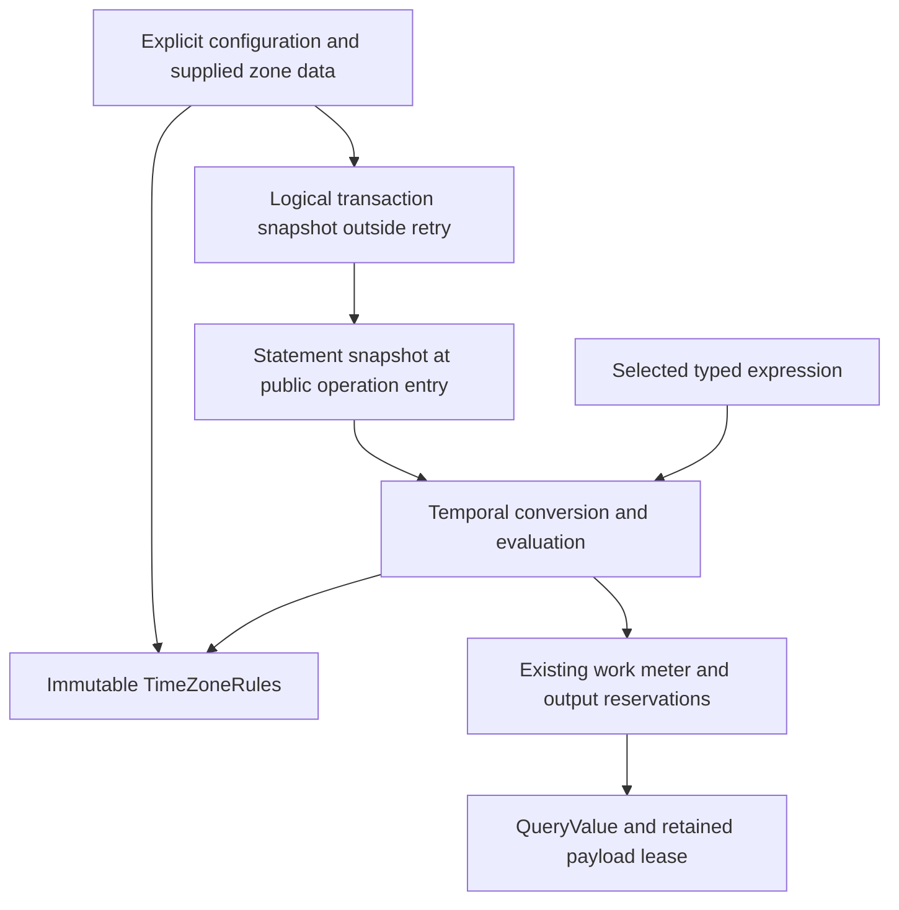

# SQL Temporal Evaluation

## Purpose and Scope

This component owns the executable T07, T08 and F07 temporal semantics of the
[SQL basic compatibility profile](../../../../../database-kit/Sources/DatabaseKit/Query/SQL/DESIGN.md).
Parent: [QueryExecution](../DESIGN.md). Children:
[TimeZoneRules](TimeZoneRules/DESIGN.md) and [Formatting](Formatting/DESIGN.md).

The user included temporal and interval infinity on 2026-10-16. Semantic
requirements are frozen as S06-C01 through C11 in the SQL profile. This design
fixes implementation ownership and algorithms; source and runtime completion
remain tracked by [PROGRESS.md](../../../../../PROGRESS.md).

## Responsibilities and Boundaries

| Responsibility | Owner |
|---|---|
| SQL temporal value and type metadata, intrinsic declared-value admission, Wire and persistence adaptation | DatabaseKit Query/SQL and their existing consumers |
| SQL lexical conversion, precision rounding, calendar arithmetic, comparison and temporal formatting | SQLTemporal |
| Validated immutable supplied TZif data, transition and recurring-rule lookup | TimeZoneRules |
| Logical transaction and statement snapshots, live wall clock, configured session zone and lifetime | Core, Transaction and Read execution owners |
| Overload selection, common types and result/nullability metadata | Canonical query binder |
| SQL text grammar, lowering and occurrence ranges | QueryAST |

This component consumes an explicit evaluation environment. It does not discover
the process timezone, obtain clocks from a global service, manage transactions,
change primitive FieldValue meaning, or acquire storage authority.

## Related Designs

| Design | Relationship | Contract Used | Summary | Cautions |
|---|---|---|---|---|
| [QueryExecution](../DESIGN.md) | parent | Selected scalar execution and retained payload claims | Integrates the temporal kernels with relational evaluation. | Binding precedes evaluation; output retains its meter lease. |
| [TimeZoneRules](TimeZoneRules/DESIGN.md) | child | Validated supplied rules and bounded lookup | Provides deterministic timezone interpretation. | Unavailable rules fail; a last offset is not a substitute for a missing footer. |
| [Formatting](Formatting/DESIGN.md) | child | Bounded temporal text input/output | Implements exact template and plaintext formatting. | Uses the selected overload and explicit environment. |
| [SQL profile](../../../../../database-kit/Sources/DatabaseKit/Query/SQL/DESIGN.md) | depends on | T07, T08, F07 and product differences | Owns accepted SQL meaning and query values. | S06-C01 through C11 are the semantic authority. |
| [Core](../../Core/DESIGN.md) | coordinates with | Injected configuration and operation entry | Owns reusable environment configuration and wall-clock service. | Default session zone is deterministic UTC. |
| [Transaction](../../Transaction/DESIGN.md) | coordinates with | Logical transaction binding and retry | Carries transaction-stable time across attempts and attenuation. | Capture before retry, not in the attempt's actor initializer. |
| [Read](../../Read/DESIGN.md) | coordinates with | Read execution and derived sessions | Carries statement-stable time through rows and subqueries. | Internal reentry must not start a new statement clock. |
| [Mutation](../../Mutation/DESIGN.md) | used by | Selected assignment and predicate evaluation | Uses the same temporal scalar semantics as SELECT. | Validate before reads and retain results through persistence. |
| [QueryAST](../../../QueryAST/DESIGN.md) | coordinates with | Temporal syntax and source occurrences | Lowers special SQL forms into the semantic model. | A successful parse is not evidence of executable support. |

## Architecture



## Contracts and Invariants

### Verified current facts and required changes

| Current fact | Required change |
|---|---|
| Binder's function catalog has no F07 temporal signatures; temporal arithmetic encounters its numeric-only gate. | Select exact input/result types, NULL behavior, volatility and execution capability before evaluation. |
| Non-NULL temporal precision casts are explicitly rejected; time-with-zone has no value carrier. | Consume Kit-owned SQL carriers and apply finite range, microsecond and typmod conversions without changing primitive invariants. |
| QueryIntervalValue retains months, days and microseconds; primitive structural identity is not SQL interval equality. | Compare with PostgreSQL's 30-day-month/24-hour-day convention while retaining original components for arithmetic and output. |
| Core injects WallClock, but SQL transaction/statement snapshots are absent. | Pass the operation-owned environment explicitly to SELECT and Mutation kernels. |
| Existing selected scalar execution supports an optional database context. | Add temporal environment separately; do not fabricate a database context to evaluate a scalar. |

The facts above are traceable to
[CanonicalQueryTypeBinder](../CanonicalQueryTypeBinder.swift),
[CanonicalSQLValueSemantics](../CanonicalSQLValueSemantics.swift),
[the shared scalar entry](../DatabaseContext+CanonicalRows.swift),
[DBConfiguration](../../Core/DBConfiguration.swift), and
[transaction binding](../../Transaction/ActiveDatabaseTransactionContext.swift).

### Finite values and deterministic policy

- SQL DATE/TIMESTAMP range and BC conversion are enforced at the SQL boundary;
  DatabaseTypes continues to enforce only its intrinsic primitive invariants.
- SQL precision is 0 through 6. Lexical fractional input and timestamp typmod
  rounding are distinct operations. Typmod ties follow PostgreSQL's signed
  microseconds relative to its 2000 epoch, including carry and final overflow.
- TIME retains the distinct 24:00 endpoint. TIMETZ additionally retains its
  explicit offset; the query carrier stores seconds east of UTC.
- Calendar months, calendar days and elapsed microseconds are applied in that
  order. Month-end adjustment and DST changes do not turn a calendar day into
  an unconditional 24-hour duration.
- UTC and fixed offsets are always available. Named IANA zones require supplied
  immutable rules. A gap chooses the pre-transition offset and a fold chooses
  the post-transition offset, matching the pinned PostgreSQL behavior.
- Literal numeric offsets use ISO east-positive signs. Textual zones used by
  TIMEZONE/AT TIME ZONE use PostgreSQL's POSIX sign convention. Their accepted
  offset bounds are separate; lexical +16 rejection does not imply rejection
  of the textual zone '+16'.
- Formatting uses deterministic Gregorian, ISO and C/POSIX conventions under
  the accepted profile. Unsupported directives are explicit typed failures;
  parsing must not silently select another format or host calendar.

### Clock assumptions and guarantees

The execution environment supplies transaction time, statement time, a live
WallClock, and the configured zone/rules snapshot. NOW and
TRANSACTION_TIMESTAMP use transaction time; STATEMENT_TIMESTAMP uses statement
time; CLOCK_TIMESTAMP reads the live clock for each evaluated occurrence.
CURRENT_DATE/TIME/TIMESTAMP and LOCALTIME/LOCALTIMESTAMP derive from the
transaction snapshot in the configured zone and apply their selected precision.

Implicit transaction time equals statement time. Explicit logical transaction
time is captured outside retry and inherited by nested/admitted read bindings.
Statement time is captured once at the public SQL or Mutation operation entry,
outside read retry. Subqueries, authorized derived sessions and Composition
member/decision reads inherit the same statement environment. Read attenuation
retains clock state even when it removes the DatabaseTransaction actor handle.
Monotonic deadlines remain separate from SQL wall-clock values.

The lexical surface is defined by the SQL profile S06-C01...C11 and its common
input forms. Relative lexical terms resolve from `transactionInstant`, never
from the host clock or process locale. Interval synthetic calendar tokens fail
when a signed-Int32 stage used by that token leaves PostgreSQL's defined domain;
plain component output remains available over the full admitted interval domain.

## Runtime Flows

```text
admit operation and capture statement environment
  -> bind names, overloads, casts and temporal modifiers
    -> execute with inherited logical transaction time
      -> convert input / look up explicit zone rules / apply calendar operation
        -> admit output footprint before materialization
          -> publish QueryValue with its retained claim
```

Public syntax includes CURRENT_* and LOCAL* optional precision, EXTRACT's field
and FROM operand, AT TIME ZONE, interval field ranges and existing ordinary
temporal function calls. Lowering must preserve every child occurrence's source
range and argument order. QueryAST owns the final lowering/serialization choice.

S10 table-function invocations use the internal immutable `SQLTemporalConfiguration.replacing(timeZone:)` copy to select an explicit series zone. The copy retains the same named-zone provider and exact fixed-abbreviation ByteString owner; only the zone selection changes. Argument casts remain owned by the admitted statement environment. This creates no public configuration API or mutable registration.

## State, Ownership, and Lifecycle

Rules data is immutable configuration state. Query scratch, parsed formats and
temporary output are operation-owned. A query never installs a mutable global
timezone or formatting cache. Configuration admission accounts for complete
retained rules owners; each query accounts for its lookup work, scratch and
output without pretending a large owner's visible slice is its retained size.
Clock environments are immutable Sendable snapshots shared by inherited
execution scopes. Live WallClock remains the injected Sendable capability.

## Failure, Concurrency, and Constraints

Malformed lexical input, range/precision overflow, unavailable or malformed
zone data, invalid field/format and unsupported signatures remain distinguishable
typed failures. Cancellation, deadline and work-limit failures propagate through
the existing meter. Long input/format scans checkpoint; all checked sizes and
reservations precede allocation or output growth. Failure releases scratch and
unpublished output. Shared source uses identical ownership and isolation across
Native, WASM and Embedded.

## Verification and Change Impact

| Contract | Falsifiable behavior |
|---|---|
| Finite carriers and precision | SQL boundary limits, BC/leap dates, half ties on both sides of 2000, midnight carry, TIME24 and offset-preserving TIMETZ round trips. |
| Calendar and interval semantics | Mixed signs, month-end adjustment, DST calendar-day versus elapsed-time differences, interval modifiers and comparison/hash consistency. |
| Zone capability | UTC/fixed signs, supplied New York gap/fold, Lord Howe non-hour DST, historical seconds and recurring rules after explicit transitions; unknown/malformed/missing-footer failures. |
| Clock ownership | Advancing injected clock, repeated occurrences/rows, multiple statements in one logical transaction, retries and Composition inheritance; volatile evaluation counts. |
| Functions and formats | Every selected F07 name/overload, result metadata, NULL/invalid fields, round trips, unsupported formats and exact/one-past resource limits. |
| End-to-end execution | Public SQL text through binding and results; Mutation assignment/predicate and nonmutation on failure; retained-owner release and cancellation. |
| Portability | Exact pinned Native and ordinary/Embedded target compile/link/runtime for the component; Graph-enabled Database integration remains the agreed S18 lane. |

The owning tests are DatabaseEngineTests and public DatabaseTests, with Kit/Wire
and QueryAST tests owned by their respective contracts. Source-backed oracle
observations are retained under the task's sql-s06-evidence directory; they are
PostgreSQL reference evidence, not Framework implementation passes. Changes to
the environment revalidate Core/Transaction/Read and Composition inheritance;
value changes revalidate Kit/Wire/persistence/CLI; kernel changes revalidate the
selected binder, SQL equality and Mutation callers.


### S06 implementation interfaces and case ownership

SQLTemporalEnvironment is immutable Sendable with transactionInstant,
statementInstant, wallClock and configuration. SQLTemporalConfiguration has
TimeZone.utc, fixed(offsetSeconds:Int32), or named(SQLTimeZoneRules), an optional
SQLTimeZoneRulesProvider, and admitted immutable fixed abbreviation bindings.
An already validated named rules handle is configured explicitly; no lazy host
lookup is needed at bootstrap. fixedOffset(forAbbreviation:workMeter:) performs
metered ASCII lookup. Supplied registry count/retained limits are explicit;
retained records use one exact byte owner, not input String capacity guesses.

CanonicalSQLTemporalEvaluator owns evaluate(bound,operands,environment,meter),
cast(value,from,to,context,environment,meter), compare(lhs,rhs,leftType,rightType,
environment,meter), and identity(value,type,environment,meter). Fixed kernels
return QueryValue; Formatting returns any required retained output lease.
SQLTemporalIdentity is a fixed Hashable family/rank/Int128 scalar/Int64 offset
key. Calendar/epoch conversion uses checked Int128 where the full PostgreSQL
upper timestamp cannot fit Unix microseconds in Int64, then stores floor Unix
seconds and nonnegative nanos in the existing Timestamp primitive.

Implementation files split calendar, lexical temporal input, interval input,
precision, arithmetic, function fields/constructors, identity and the selected
facade. Ordinary algorithms use bounded local state; only the lexical and
transition scans grow with admitted input. Public kernel entry does not
re-resolve overloads or create a database context. Absent environment is a
failure for a temporal operation, while unchanged non-temporal scalar callers
may retain an optional environment parameter.

Root owns configuration/environment and runtime propagation. Kit owns values,
type admission, persistence and codecs. The syntax/Wire owner owns currentValue
metadata and all no-child traversals. Kernel, Formatting and TimeZoneRules own
their respective source/test directories. Binding/evaluation integration owns
Binder/Bound/Rows, ScalarCast/ScalarText relays, typed SQL identity and Mutation.
Directory/index and durable retirement own their descriptor-aware codecs.

Case families S06-I01...I10 cover selected signatures, common types, lexical
versus typed text, clocks, interval hash boundaries, TIMETZ/TIME24, infinity,
text leases, pushdown and portable results. S06-M01...M06 belong to Mutation.
Rules and Formatting child designs own their detailed case matrices. S06-C01
through C11 are verified through public SQL and persistence in addition to
focused kernel tests; reference oracle results alone do not close them.
